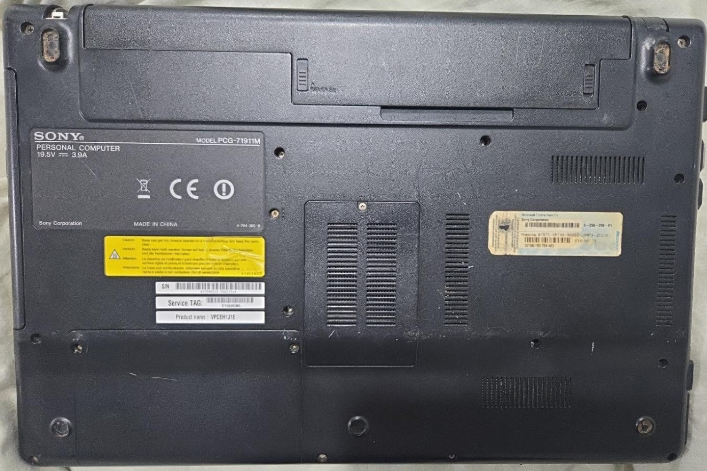
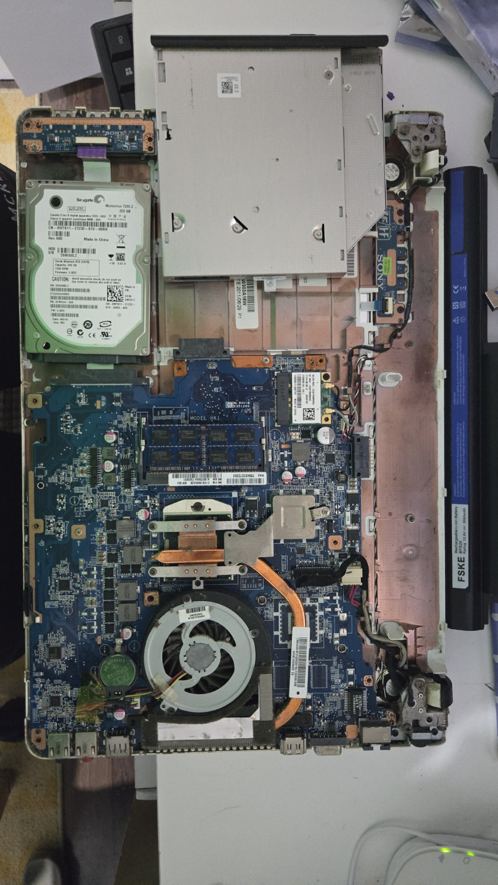
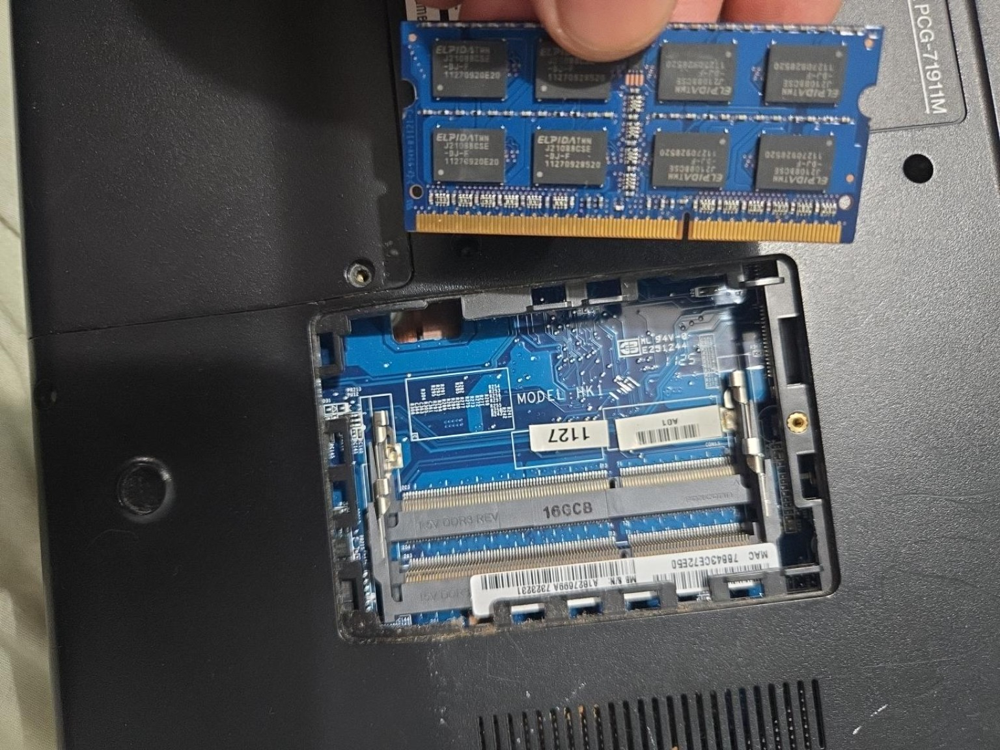
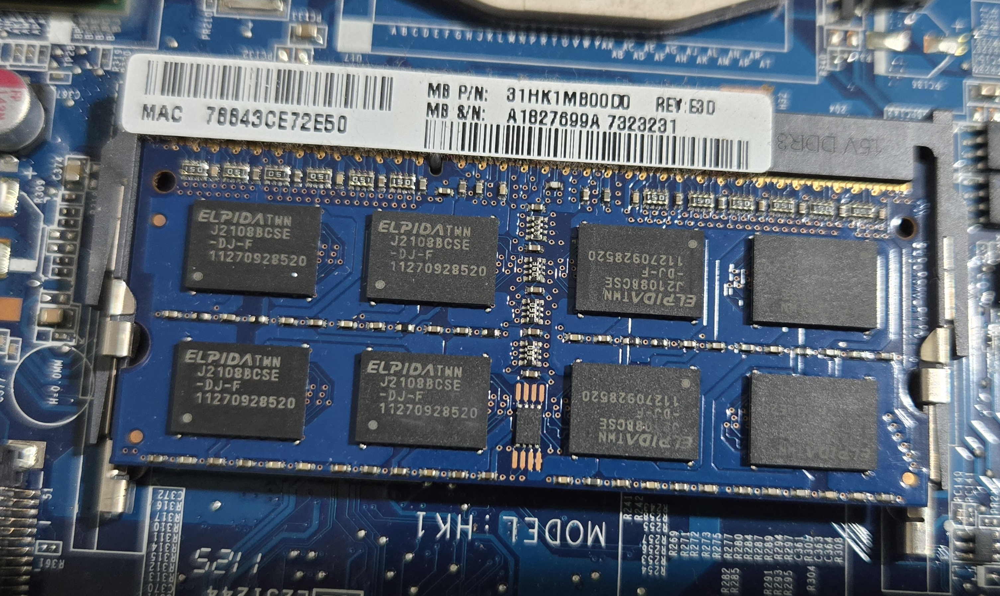
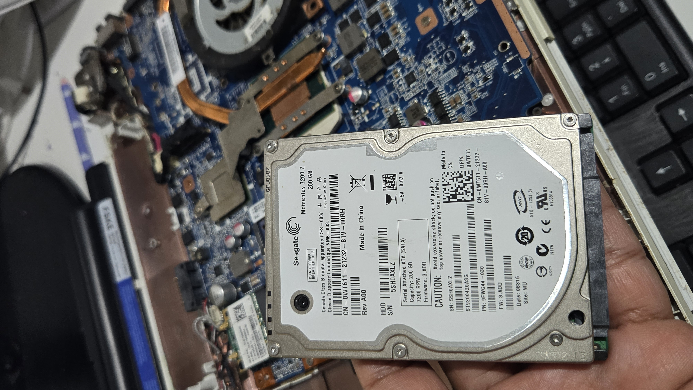
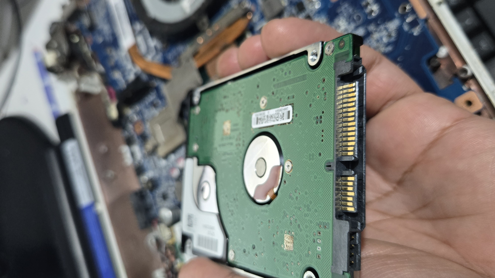
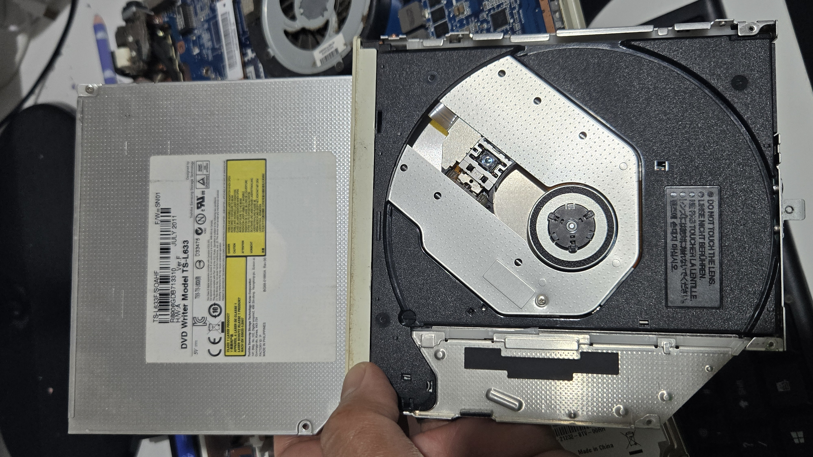
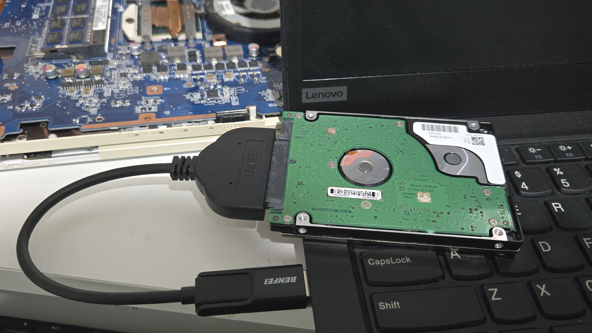

# Laptop Hardware Inspection & Data Recovery

### CompTIA A+ Practical Hardware Project

**Project Type:** Personal IT Support Lab  
**Device:** Sony VAIO Laptop (PCG-71911M)  
**Focus:** Hardware Identification, Disassembly, Storage Interfaces & Data Recovery  
**Author:** Jahidul Islam

---

## 1. Project Overview

As part of my CompTIA A+ training and transition into the IT industry, I carried out a hands-on hardware inspection of my approximately 15-year-old Sony VAIO laptop.

The laptop was no longer powering on. Its replacement battery had also stopped working after approximately two years.

My primary objective was to gain practical experience with computer hardware by identifying internal components, understanding their functions, and examining how they connect to the motherboard.

As an additional exercise, I removed the internal hard disk and used a USB-to-SATA adapter to access and recover my old photographs and documents.

This project demonstrates practical hardware knowledge relevant to entry-level IT Support and Junior IT Technician positions.

---

## 2. Project Objectives

- Gain practical experience inspecting laptop hardware.
- Identify key internal computer components.
- Understand motherboard connections and hardware interfaces.
- Examine RAM modules, slots and installation mechanisms.
- Identify the wireless network interface card.
- Examine the processor cooling system.
- Inspect SATA HDD connections and storage technology.
- Understand the optical drive mechanism.
- Recover personal files from a removed laptop HDD.
- Document practical learning for CompTIA A+ and IT Support.

---

## 3. Hardware Information

| Component | Details |
|-----------|---------|
| Manufacturer | Sony |
| Laptop Model | VAIO PCG-71911M |
| Storage | Seagate Momentus 7200.2 |
| HDD Capacity | 200 GB |
| HDD Speed | 7200 RPM |
| Storage Interface | SATA |
| Memory | Removable laptop SO-DIMM modules |
| Wireless Adapter | Atheros AR5B195 |
| Optical Drive | TS-L633 DVD Writer |
| Cooling | Fan, copper heat pipe and heatsink |
| Data Recovery Connection | USB-to-SATA adapter |

---

## 4. Laptop Disassembly & Inspection

I opened the laptop to inspect its internal hardware and understand how different components work together.

During the inspection, I identified the motherboard, memory, wireless adapter, storage device, cooling assembly, optical drive and internal connectors.

The original photographs below document the components I examined.

### Motherboard Overview

The motherboard provides electrical connections and communication pathways between the processor, memory, storage, networking hardware and other components.

### RAM Inspection

I examined the laptop's removable SO-DIMM memory modules, their slots, gold contacts and retaining clips.

RAM provides temporary working memory used by the operating system and applications.

### Hard Disk Drive

The laptop contained a 200 GB Seagate Momentus mechanical hard drive operating at 7200 RPM.

Unlike solid-state drives, HDDs store data magnetically on rotating platters.

### SATA Connections

I examined the SATA data and power connections used by the HDD.

SATA uses separate connectors for transferring data and supplying electrical power.

### Optical Drive

I inspected the DVD writer assembly, including its disc spindle and optical pickup mechanism.

---

## 5. Data Recovery

One of the practical outcomes of this project was recovering personal photographs and documents from the old laptop HDD.

### Procedure

1. Removed the HDD from the laptop.
2. Identified its SATA connection.
3. Connected the HDD to a USB-to-SATA adapter.
4. Connected the adapter to another computer.
5. Accessed the stored files.
6. Recovered the required personal photographs and documents.

### USB-to-SATA Data Recovery Connection

The photograph shows my removed 2.5-inch SATA hard drive connected to another laptop using a BENFEI USB-to-SATA adapter.

This allowed the drive to be accessed externally without requiring the original Sony VAIO laptop to power on.

**Technical observations:**
- Storage device: 2.5-inch SATA HDD
- Capacity: 200 GB
- Speed: 7200 RPM
- Connection: SATA to USB adapter
- Recovery method: Accessing and retrieving files from an external drive

This exercise demonstrated a practical method of recovering personal data from a laptop that was no longer operational.

### Result

**Personal files were successfully accessed and recovered from the removed HDD.**

This exercise demonstrated how a laptop storage device can be accessed independently of its original computer.

---

## 6. Troubleshooting Observations

The laptop was no longer powering on, and its replacement battery was reported to have failed.

The project focused on hardware learning and data recovery rather than a complete electrical fault diagnosis.

Without testing the AC adapter, charging circuit and other components, the precise cause of the power failure cannot be conclusively confirmed.

Importantly, the HDD remained accessible through an external USB-to-SATA connection.

---

## 7. Skills Developed

- Laptop disassembly and hardware inspection
- Motherboard component identification
- SO-DIMM RAM inspection
- Storage device identification and removal
- SATA interface recognition
- Wireless network adapter identification
- Cooling system inspection
- USB-to-SATA connectivity
- File access and practical data recovery
- Technical documentation

---

## 8. CompTIA A+ Learning Outcomes

This project reinforced my understanding of several CompTIA A+ hardware topics:

- Laptop hardware components
- Memory technologies and form factors
- Hard disk drives and storage interfaces
- Wireless networking hardware
- Cooling and thermal management
- Peripheral and optical storage devices
- Hardware troubleshooting principles

---

## 9. Conclusion

This hands-on project allowed me to connect CompTIA A+ theoretical knowledge with practical computer hardware experience.

By physically inspecting the internal components of an older laptop and recovering data from its HDD, I developed a better understanding of computer architecture, hardware connectivity and basic IT support procedures.

This project forms part of my ongoing technical training and GitHub portfolio as I work towards a professional career in IT Support and Cybersecurity.

---

**Jahidul Islam**  
CompTIA Security+ Certified | IT Career Switch Trainee

